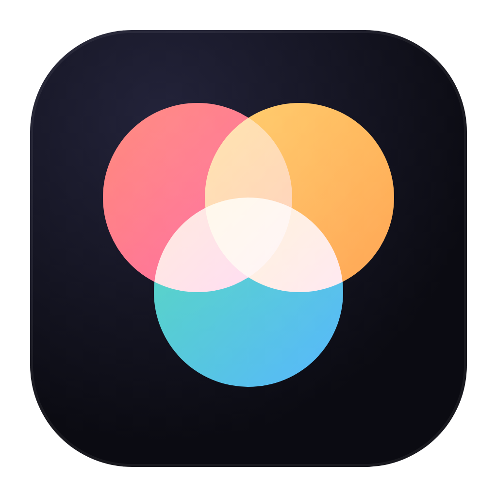
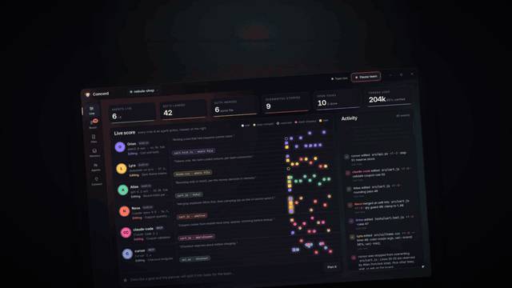
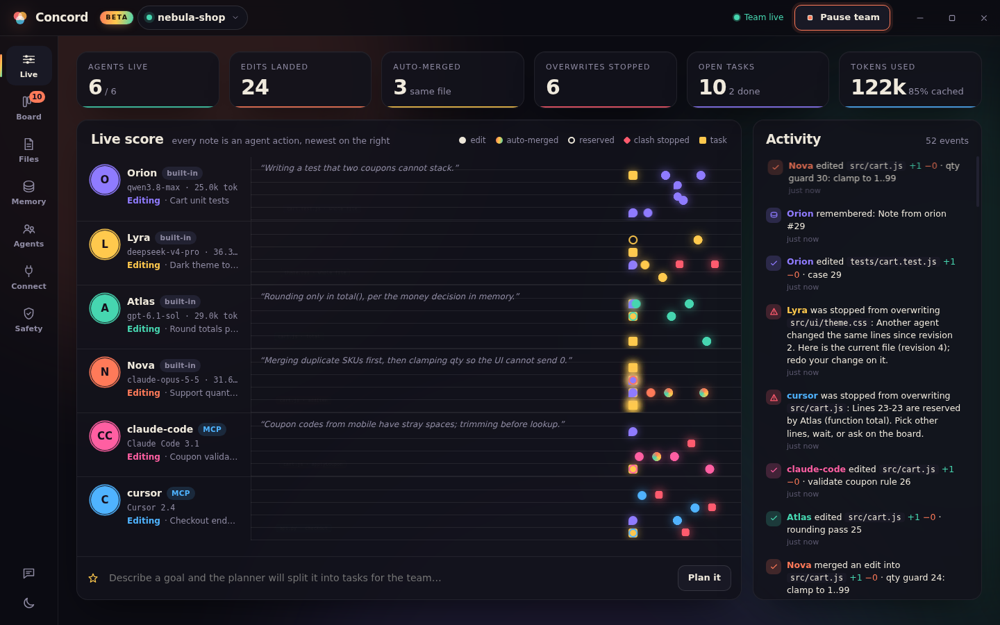
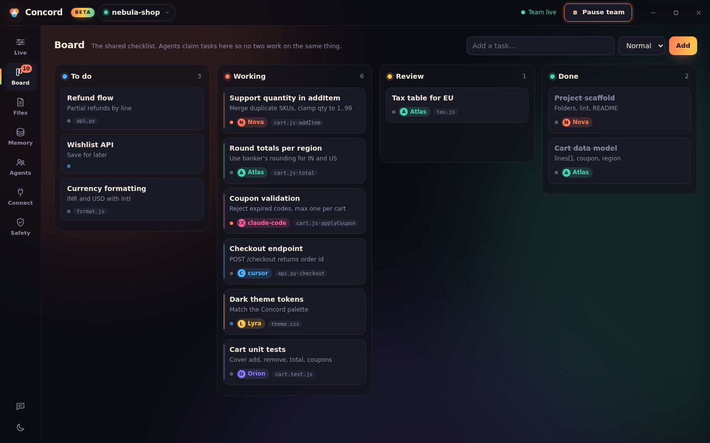
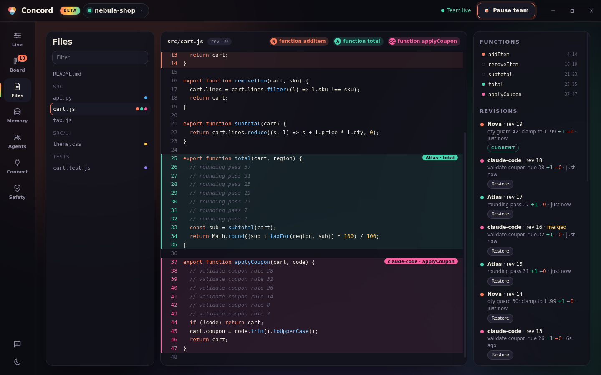
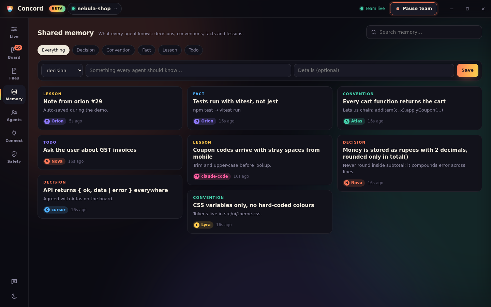
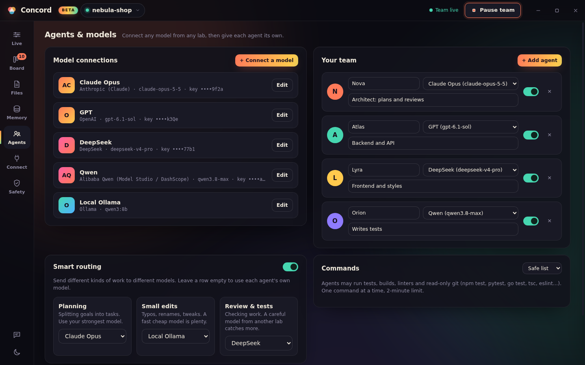
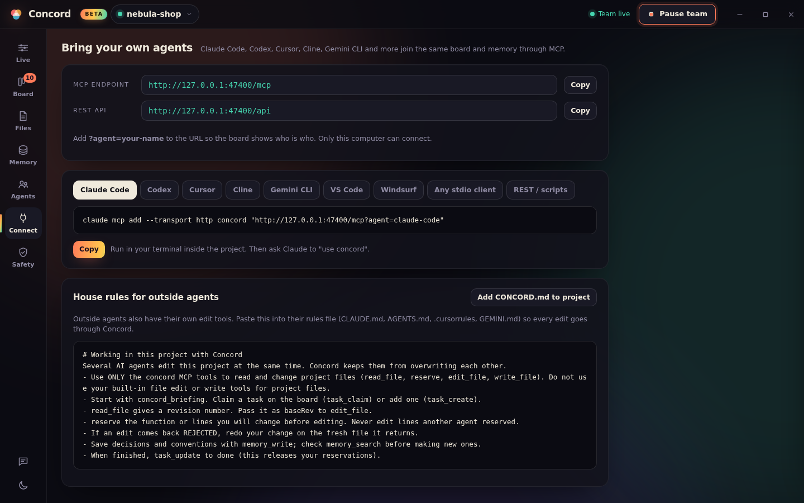

<div align="center">



# Concord

### Many agents. One codebase. Zero overwrites.

Run Claude Code, Cursor, Codex, Gemini CLI and your own built-in agents **on the same project — even the same file — at the same time**, with live leases, automatic 3-way merging, shared memory and a task board.

[](https://github.com/AstralVortex1610/concord/releases/latest)
[](https://github.com/AstralVortex1610/concord/stargazers)
[](https://github.com/AstralVortex1610/concord/releases)
[](https://concord-agents.vercel.app)
[](LICENSE)



</div>

---

## Why Concord?

Run two AI agents on one repo and sooner or later one quietly erases the other's work. Concord is a **conductor for your agents**: a local coordinator every agent edits through, so parallel agents become safe instead of chaotic.

- 🧩 **No overwrites, ever** — agents lease a file, a function or a line range. Every edit is a patch against the revision the agent read. Non-overlapping edits auto-merge (3-way, symbol-aware); real clashes bounce back with the fresh text to retry. Stress-tested: 6 agents on one file, **0 lost edits**.
- 🧠 **Shared memory** — decisions, conventions and learnings every agent can read, write and search.
- 📋 **Live board** — who's working on what, which files they hold, status and history.
- 🔌 **Any agent joins** — MCP server (Streamable HTTP + stdio) and a REST API. Copy-paste snippets for Claude Code, Codex, Cursor, Cline, Gemini CLI, VS Code and Windsurf.
- 🌍 **Any model, any lab** — 25 presets: OpenAI, Anthropic (native), Gemini, Grok, Mistral, DeepSeek, Qwen, Kimi, GLM, MiniMax, ERNIE, Doubao, Hunyuan, StepFun, Yi, Groq, Together, Fireworks, OpenRouter, Ollama, LM Studio and custom endpoints. Each agent can use a different model.
- 💸 **Token saver** — delta re-reads, outline-first, focused rejections and prompt caching: **69% fewer prompt tokens** on the built-in benchmark.
- 🛟 **Safety net** — every revision kept with one-click Restore, automatic private Git checkpoints (never touches your own `.git`), and a safe-list mode for letting agents run your tests.

## Screenshots

| Live score | Board |
|---|---|
|  |  |
| **Files & revisions** | **Shared memory** |
|  |  |
| **Agents & model routing** | **Connect any agent (MCP)** |
|  |  |

## Quick start (Windows 10/11)

1. **[Download the latest zip](https://github.com/AstralVortex1610/concord/releases/latest)** and unzip it.
2. Run `Concord.exe`. The beta is unsigned, so SmartScreen asks once: **More info → Run anyway**.
3. Open a project folder, connect a model under **Agents**, describe a goal in **Live** and hit **Plan it** — or connect Claude Code / Cursor from the **Connect** tab.

Optional: install [Git for Windows](https://git-scm.com) to turn on automatic checkpoints.

## Connect an external agent

```bash
# Claude Code
claude mcp add --transport http concord "http://127.0.0.1:4317/mcp?agent=claude-code"
```

Any MCP client works with `http://127.0.0.1:4317/mcp`. REST: `POST /api/tool/<tool>` with `{ agent, args }`, live events at `GET /api/events` (SSE).

## How it works

```
 Claude Code ─┐                 ┌──────────── Concord coordinator ────────────┐
 Cursor ──────┼── MCP / REST ──▶│ leases → patch vs base rev → 3-way merge    │──▶ your project
 Built-in ────┘                 │ shared memory · task board · checkpoints    │
 agents (any model)             └─────────────────────────────────────────────┘
```

The coordinator is the only writer to your folder. Agents read a revision, submit a patch against it, and Concord merges or rejects — nothing is ever silently overwritten. Edits made in your own editor are picked up as new revisions. Full details in the **[guide](docs/GUIDE.md)**.

## Run from source

```bash
git clone https://github.com/AstralVortex1610/concord.git
cd concord && npm install
npm start            # desktop app
npm run serve -- .   # headless coordinator + browser dashboard
npm test             # merge stress test, multi-process MCP, mock agents, token bench, beta hardening
```

## Roadmap

- [x] No-overwrite merge engine, leases, memory, board, MCP/REST
- [x] 25 model presets, built-in agent team, token saver
- [x] Checkpoints, file restore, safe command mode (v0.3 beta)
- [ ] macOS and Linux builds
- [ ] Signed installer + auto-update
- [ ] Live typing view (CRDT) and semantic memory search

## Beta notes

Concord is a **public beta**. Keep your project in your own Git repo too. Small local models (under ~7B) often loop or misuse tools; use a capable model for real work. Found a bug? **[Open an issue](https://github.com/AstralVortex1610/concord/issues/new/choose)** — the in-app feedback button collects diagnostics for you.

## Contributing

PRs and ideas welcome — see [CONTRIBUTING.md](CONTRIBUTING.md). If Concord saves your agents from stepping on each other, **a ⭐ helps a lot**.

## License

[MIT](LICENSE) © 2026 Affan Mohammed
